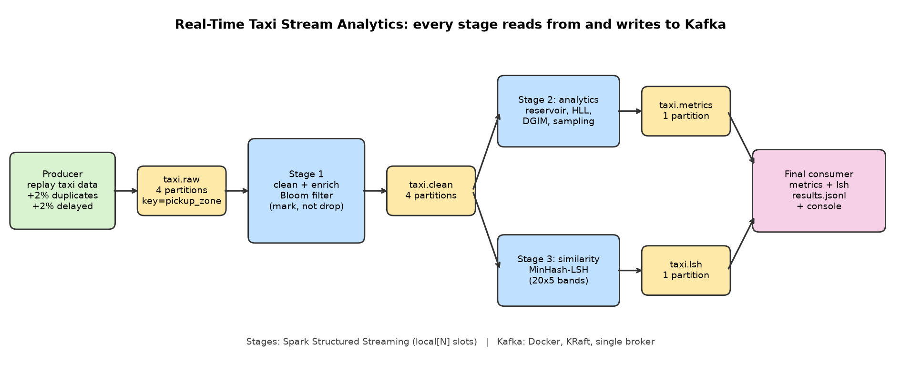

# Real-Time Taxi Stream Analytics: Kafka + Spark Structured Streaming + LSH

BDA Assignment 2. A multi-stage Kafka pipeline over NYC yellow-taxi trips (January 2026).
After the producer, every stage reads from a Kafka topic and writes to a Kafka topic.



```
producer -> taxi.raw -> Stage 1 (clean, enrich, Bloom) -> taxi.clean
                                    |-> Stage 2 (sampling, HLL, DGIM) -> taxi.metrics --\
                                    |-> Stage 3 (MinHash-LSH)         -> taxi.lsh     ---+-> final consumer -> results.jsonl
```

## 1. Technology choice

**Spark Structured Streaming (PySpark 3.5.1, Python 3.12) with Kafka as the only link between stages.**
Each stage is a Spark job with a Kafka source (`readStream`, offsets stored in a checkpoint) and a `foreachBatch`
function. Stage 1 publishes to `taxi.clean`, Stage 2 to `taxi.metrics`, Stage 3 to `taxi.lsh`.
The number of "processing slots" is Spark's `local[N]`. Reasons: it runs on a laptop without a cluster,
it gives checkpointed offsets (needed for the restart test), and Python lets us implement the sketches
(Bloom, reservoir, HLL, DGIM, MinHash) ourselves so every parameter can be reported.
Kafka runs in Docker (`apache/kafka:3.8.0`, KRaft mode, one broker).

**Machine:** Intel Core i5-1135G7 @ 2.40 GHz (4 cores), 7.7 GB RAM, Windows, Docker Desktop, Java 17 (Temurin),
Hadoop `winutils` in `C:\hadoop`. No WSL, no cloud. Kafka, three Spark JVMs and the producer share this one laptop.

## 2. How to run

**Prerequisites:** Windows, Python 3.10-3.12, Java 17, Docker Desktop (running), internet on the first run
(Spark downloads the Kafka connector). Put the taxi file at `data/yellow_tripdata_2026-01.parquet`
(path set in `config.yaml`). Hadoop `winutils.exe` and `hadoop.dll` must be in `C:\hadoop\bin`.

**Default run, one command** (about 3 minutes):

```
.\run_all.bat
```

It creates the virtual environment, installs `requirements.txt`, starts Kafka, recreates the four topics,
starts the final consumer and Stages 1-3, runs the producer, waits until the stages are idle,
and appends a row to `results/experiment_summary.csv`. Output goes to `results/results.jsonl`
(and the console). Per-process logs are in `logs/`.

**Step by step** (activate `.venv` first; each long-running command in its own terminal):

```
docker compose up -d                                    # start Kafka
python -m scripts.create_topics --recreate              # taxi.raw/clean = 4 partitions, metrics/lsh = 1
python -m final_consumer.consumer --run-id demo         # terminal 1
python -m stage1_clean_bloom.stage1 --run-id demo       # terminal 2
python -m stage2_stream_analytics.stage2 --run-id demo  # terminal 3
python -m stage3_lsh.stage3 --run-id demo               # terminal 4
python -m producer.producer --run-id demo --rate 400    # terminal 5 (Ctrl+C the stages when done)
```

**Changing parameters.** Edit `config.yaml` (all spec parameters are there) or override per run:

```
python -m scripts.run_pipeline --run-id demo --rate 800 --partitions 4 --slots 6 --key-mode none --set dgim_r=2
python -m scripts.run_pipeline --run-id demo --set bloom_bits=100000 --set reservoir_sizes=[50,500,5000]
```

DGIM query sizes: `dgim_queries`. DGIM buckets per size: `dgim_r` (we use 8, textbook is 2).
Reservoir sizes: `reservoir_sizes`. LSH settings: `lsh_bands`, `lsh_rows_per_band`, `lsh_extra_configs`.

**Reproduce all experiments:** `python -m scripts.run_experiments` (P1-P4, K2, low/medium/high, about 25 min);
repeat samples: `--only P1b,P2b,P3b,P4b`; restart test: `python -m scripts.restart_test`.

## 3. Standardized output

`results/results.jsonl` has one JSON object per Stage-2 report, in the format of the assignment (Section 9)
plus extra fields. `run_id` identifies the run. Window-level details are in `results/windows_<run>.jsonl`.
Latency in the output is Stage-2 processing time minus `producer_ts_ms`. The final consumer adds
`report_to_final_ms` (about 70 ms), so this is a close approximation of the end-to-end figure.
Events produced during Spark's first micro-batch (JVM warm-up) are excluded from latency percentiles.
Note: the producer adds one field not in the spec example, `dropoff_time`, because Stage 1 needs it for `trip_duration_min`.

## 4. Experiments and main observations

All experiment runs use the same 30,000-event taxi segment (30,568 messages with duplicates). Full table: `results/experiment_summary.csv`.

**Bloom filter (Stage 1).** The filter is sized for 200,000 IDs at a 1% target (1,917,012 bits, 7 hash functions).
With this size the 20k-30k event runs show 0 false positives and 0 false negatives. In a separate run with the
filter shrunk to 100,000 bits (`--set bloom_bits=100000`, run `bloomfp`) we measured 614 false positives out of 20,000 new IDs
(3.07%, averaged while the filter filled; the formula gives about 13.8% for a full filter) and 0 false negatives.
Examples: `results/bloom_fp_examples_bloomfp.jsonl` (first one: `2026-01-row-00006651`, after about 6,500 inserted IDs).
Duplicates are marked (`bloom_seen_before`), never dropped; ground truth comes from an exact set.

**Sampling.** Reservoir sampling of mean fare (20k-event test): error 11.7% (k=100), 1.9% (k=1,000), 0.12% (k=10,000),
roughly 1/sqrt(k). Mean trip distance behaves the same (`sampling_all` in the results). For the non-linear statistic
"fraction of pickup zones with >= 10 distinct drop-off zones per 60-min window" (equal storage budget for both methods),
event sampling underestimates in every window, for example exact 0.436 vs 0.338 and exact 0.176 vs 0.0, because a zone's
sampled events miss most of its destinations. Entity sampling (deterministic hash of the pickup zone, all events of selected zones kept)
gave 0.500 and 0.154 for those two windows: no systematic bias, but noisy because only 26-42 zones are selected.
Entity sampling is the more reliable design for this statistic because the property depends on a zone's complete behaviour.

**HyperLogLog.** Precision 12 (4,096 registers, about 3 KB) vs an exact set of about 300 KB for a 60-minute window.
Window errors were 0.08-0.21% in the 20k-event test and averaged 1.05-1.14% over windows in the 30k-event runs.
The error does not depend on partitions; it only moves with rate if late-event handling changes which events a window contains.

**DGIM.** Window 10,000, queries k = 1,000 / 5,000 / 10,000, bucket counts reported. With the textbook 2 buckets per size
the error was 9-34% (inside the 50% bound, worst when 1s are sparse); with `dgim_r=8` (65 buckets in a synthetic test) it fell
to under about 1.5% in the experiment runs. Final-report DGIM numbers are identical across runs because the last
10,000 events of the stream are the same in every run.

**LSH (window 00:00, 72 active zones, 2,556 pairs, 377 truly similar pairs; 100 hashes).**

| Bands x rows | Candidates | Recall | Candidate precision | Reduction | LSH time | Exact all-pairs |
|---|---|---|---|---|---|---|
| 20 x 5 (default) | 373 | 0.63 | 0.64 | 0.85 | 19.8 ms | 15.0 ms |
| 25 x 4 | 816 | 0.93 | 0.43 | 0.68 | 24.3 ms | |
| 10 x 10 | 21 | 0.05 | 0.86 | 0.99 | 15.2 ms | |

More bands with fewer rows lower the effective similarity threshold: more candidates, higher recall, lower precision.
Many true pairs sit just above Jaccard 0.5, so the default 20 x 5 misses a third of them. With only about 75 zones the exact
all-pairs baseline is cheaper than LSH (signature cost dominates), so LSH's time advantage does not appear at this scale.

**Partitions and consumers (P1-P4), 600 events/s offered, key = pickup_zone; two samples each.**

| Run | Partitions / slots | Stage 1 eps | Stage 2 eps | p50 latency ms | p95 latency ms | Max lag clean / raw | Skew |
|---|---|---|---|---|---|---|---|
| P1, P1b | 1 / 1 | 464, 466 | 504, 488 | 6307, 3825 | 10772, 5793 | 2187/2736, 1318/1092 | 1.00 |
| P2, P2b | 4 / 1 | 466, 453 | 505, 469 | 11533, 6776 | 15716, 8497 | 4278/3971, 1691/1823 | 0.277 |
| P3, P3b | 4 / 4 | 464, 451 | 511, 487 | 16062, 5344 | 20460, 8177 | 3146/6394, 1252/2464 | 0.277 |
| P4, P4b | 4 / 6 | 457, 448 | 485, 485 | 5134, 4802 | 7789, 7177 | 1098/1817, 1566/1835 | 0.277 |

Throughput stayed between 469 and 511 events/s for every configuration; more partitions or slots did not help.
All sketch updates run in one single-threaded Python loop on the Spark driver, so partitions and slots only parallelise
Kafka fetching and parsing, which was not the bottleneck (the laptop has 4 cores shared with Kafka and three JVMs).
Latency varies more between repeats of the same configuration (P3: 16.1 s vs 5.3 s) than between configurations,
so we do not rank P1-P4 by latency. P4 (6 slots) does not beat P3 (4 slots): with 4 partitions Kafka assigns at most one
consumer per partition and Spark creates one task per partition, so two of six slots have no data.

**Partition key (K1 vs K2), 4 partitions, 4 slots.** K1 (key = pickup_zone, runs P3/P3b): skew 0.277, 487-511 events/s.
K2 (no key, random distribution): skew 0.260, 487 events/s, p50 4.1 s. No measurable throughput difference.
Neither needed a repartition or shuffle, because per-zone state is held in the driver in both cases.
K1 keeps all trips of a zone in one partition in order; K2 balances load slightly better but gives up that ordering and locality.

**Producer rate (4 partitions, 4 slots).**

| Rate | Produced/s | Processed/s | p50 ms | p95 ms | Max lag | HLL err % | DGIM err % | LSH recall | Late discarded |
|---|---|---|---|---|---|---|---|---|---|
| Low | 150 | 142 | 3400 | 4579 | 323 | 1.09 | 0.59 | 0.609 | 0 |
| Medium | 400 | 353 | 4269 | 7951 | 1152 | 1.08 | 0.00 | 0.609 | 25 |
| High | 900 | 684 | 8902 | 11177 | 2792 | 1.14 | 1.44 | 0.602 | 188 |

The pipeline sustains about 450 events/s; at 900/s lag builds. The 3.4 s latency floor at low rate comes from the 1-second
micro-batch trigger and two Spark hops. Quality barely changes with rate, except the number of discarded late events:
the producer delays events by wall-clock seconds, so at higher rates the same delay spans more event time and more events
arrive after their window was finalized.

**Late events (event time).** Tumbling 60-minute event-time windows; watermark = maximum event time seen; allowed lateness 30 minutes;
a window result is emitted when watermark >= window end + 30 min. A late event whose window is still open is included;
once emitted, a window is not updated and later events for it are discarded and counted. Default run: 279 included, 25 discarded.
Included example (`results/late_events_default.jsonl`): `2026-01-row-00008401`, event time 00:55:39, window 00:00-01:00, watermark 01:00:09
(4.5 min behind). The window had ended but was still within the allowed lateness, so the event was included.
Discarded example: `2026-01-row-00008097`, event time 00:53:32, same window, watermark 01:30:21 (36.8 min behind). The window had
already been finalized (watermark >= 01:00 + 30 min), so the event was discarded and counted.
(Duplicate re-sends also count here, since they arrive after their original.)

**Restart and recovery** (`results/restart_test.json`). Producer at 200/s; Stage 2 killed (hard) after 40 s, down for 30 s, restarted with its checkpoint.
Lag grew from 234 to 6,727 during the outage and drained to 276 within 12 s of Stage 2 being ready.
Offsets survived: the committed offsets stayed frozen during the outage and the restart resumed from them; Stage 2 processed exactly 30,568 events
of the 30,568 in `taxi.clean`. Batch 21 was planned but not committed at the kill and was the first batch after the restart, so Spark replayed it
with the same offsets (at-least-once). No duplicates were observed: no batch ran twice and every window was emitted once.
Application state was lost: the sketches and windows restarted empty, so window 00:00 was emitted with 2,343 events instead of 9,271 (no-failure run P3)
and nothing in the output flags this. Windows entirely after the restart matched P3 exactly.

## 5. Known limitations

- Sketch state, windows and the watermark live in driver memory; a crash loses them (see restart test). Snapshotting state to Kafka or using an engine with managed state (Flink, Kafka Streams) would fix this.
- Throughput is limited by the single-threaded Python sketch loop, so P1-P4 show no scaling. Latency numbers on a shared laptop are noisy (run-to-run spread is larger than configuration effects).
- Consumer lag is computed from the checkpoint's committed offsets vs. topic end offsets (Spark does not commit to a Kafka consumer group), for `taxi.clean` in Stage 2 and `taxi.raw` in Stage 1.
- The rate experiments use 150/400/900 events/s, scaled to this machine (about 450/s sustainable), not the 1,000/s of the example config.
- Windows are not re-emitted after late updates; events later than the allowed lateness are dropped from analytics.
- Kafka is a single broker (replication factor 1). Only the Windows setup was tested.
